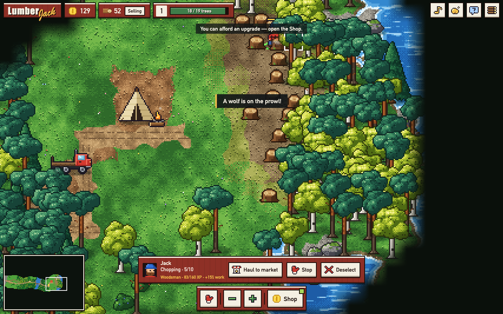

# Lumberjack

A 2D pixel-art browser game about a laid-off software engineer who takes a job cutting down a forest in Finland, building a logging village and automating it, until the land is cleared. What it was cleared for is revealed at the end.

The design is in [docs/GAME-PLAN.md](docs/GAME-PLAN.md), the original brief, and [docs/REQUIREMENTS.md](docs/REQUIREMENTS.md), a decision log of every request made since.



## Play

```bash
make
```

Opens the development game at http://localhost:5173 (needs Python 3). The server binds to this computer only and includes the recording API. There is no compilation step or dependency installation: the game is plain HTML, CSS and JavaScript.

The game saves itself in the browser as you play. Tap **?** in the game for the controls. Share it from the opening screen. On supported browsers, **Install game** adds it to your device; on iPhone/iPad use Safari's Share → Add to Home Screen. After one online visit, the game works offline (recorded voices need a connection).

Production is a static site deployed through Coolify. Run `make release` to check and package the game into `dist/`; hosting publishes only that directory. Production needs no Python process, recording API, application server or credentials. See [deployment and release checks](docs/DEPLOYMENT.md) for the release flow and verification steps.

Before each release, bump `CACHE` in `sw.js` whenever the HTML, CSS or game scripts change, and include any new game scripts in `CORE`. An update waits until all game tabs close; reopen to use it. For local development, use the browser's service-worker **Bypass for network** option (or unregister it) to see live edits after the first visit.

## Other commands

| Command | What it does |
| --- | --- |
| `make` | Start the game and open it in the browser |
| `make check` | Syntax-check every script (needs Node) |
| `make test` | Syntax-check, then run the tests |
| `make playtest` | Play whole campaigns with a scripted player and report how they went |
| `make dist` | Copy the production game files into `dist/` |
| `make preview` | Package and serve `dist/` locally, with no recording API |
| `make release` | Check the source and prepare the production package |
| `make help` | List the commands |

`sprites.html` shows every sprite in the game.

`playground.html` is a testing playground for reviewing the arrival, levels, combat and ending. Open it with `make` running. Its scenarios run separately from your saved campaign; ending previews contain spoilers. The development server serves its game shell and assets under `/__playground__/` to bypass cached production scripts, even while another game tab is open. Restart `make` after updating the development server. `make test` covers every scene in the playground menu across levels, equipment and several map seeds.

Choose **Level 5 — thriving logging village**, **Level 8 — automated timber town**, or **Level 10 — final forest frontier** for a ready-to-play settlement: 8/12/16 jacks, completed housing, sawmills and towers, an equipped fleet, and 16%/48%/85% of the forest already cut. These presets choose their own level and equipment; the map seed is still adjustable. Logging and market hauling start immediately, with spare crew and a bulldozer awaiting orders. Wildlife, raids and normal progression continue. Use **Load / replay** to reset or **Hide controls** for more playing room.

For a developed village under attack, choose one of the four defence presets:

| Scene | Jacks | Guard towers | Forest cleared |
| --- | --- | --- | --- |
| Level 7 — village defence | 12 | 2 standard | 32% |
| Level 8 — fortified town | 14 | 3 upgraded | 45% |
| Level 9 — busy frontier | 16 | 3 upgraded | 60% |
| Level 10 — large settlement | 20 | 4 upgraded | 80% |

Each starts with a town hall, housing, mills, working trucks and logging machines, and a mix of experienced jacks. Four jacks work outside; the selected reserve holds separate positions near the towers. A raid is due in 12 seconds, then marches from a surviving hut. Reposition the reserve, recall workers or buy more defences with the staged €1,800–€5,000. Raid sizes (up to 12), recovery windows, wildlife, wages and repairs use the normal rules. Level and equipment are preset; change the map seed for different terrain and approaches. **Load / replay** resets the scenario without touching campaign saves.

Choose **Song — repeated taps on Jack** and tap about half a second apart. Jack goes through 18 responses and sings on tap 19. Wait four seconds between pokes to reset the sequence and try again. Choose **Song — crew call and response** and press **Load / replay** to hear three resting jacks sing after a three-second lead-in. The crew singalong plays once per campaign. Both recordings follow the effects volume and mute.

`voices.html` is the recording booth: every line the characters say (the jacks, the vehicles, Mr. Grant, the war cries of the forest folk) is listed, and you record it with a microphone of your choice. Use [**Wildlife sounds**](voices.html#wildlife) to find the animal cues, preview the downloaded originals and record replacements. **Use original** restores a downloaded take. Press **Use this** on the best take and the game plays it from then on; lines without a recording stay silent text bubbles. Recordings are saved as `audio/voice/*.wav` (needs `make` running).


## Layout

```
index.html     the game
sprites.html   sprite sheet
voices.html    recording booth for voice lines
playground.html scenario playground for reviewing the game
css/           styles
js/            game code (loaded in order by index.html)
audio/voice/   voice recordings made in the booth
docs/          game plan, requirements and concept art
tools/         dev server (also saves recordings from the booth)
dist/          generated static release; include with a release commit
```

## License

Code, documentation and original artwork use the [MIT license](LICENSE).
Personal voice recordings remain all rights reserved by their performers.
Downloaded creature audio retains CC0 1.0; see [audio credits and licensing](audio/CREDITS.md).
