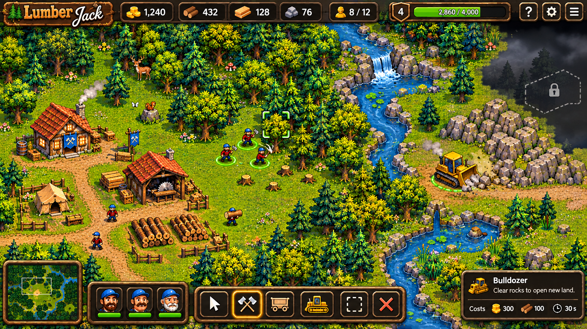

# Lumberjack

A 2D pixel-art browser game about a laid-off software engineer who takes a job cutting down a forest in Finland, building a logging village and automating it, until the land is cleared. What it was cleared for is revealed at the end.

The design is in [docs/GAME-PLAN.md](docs/GAME-PLAN.md), the original brief, and [docs/REQUIREMENTS.md](docs/REQUIREMENTS.md), a decision log of every request made since.



## Play

```bash
make
```

Opens the game at http://localhost:5173 (needs Python 3). No build step and no dependencies: it is plain HTML, CSS and JavaScript, so any static file server works too.

The game saves itself in the browser as you play. Tap **?** in the game for the controls. Share it from the opening screen. On supported browsers, **Install game** adds it to your device; on iPhone/iPad use Safari's Share → Add to Home Screen. After one online visit, the game works offline (recorded voices need a connection).

Publish the repository as a static site at `https://lumber-jack.koenvangilst.nl/` over HTTPS. The manifest, social metadata and self-hosted Plausible use that domain. Add this domain in the existing Plausible dashboard if it is not registered yet. Before each release, bump `CACHE` in `sw.js` whenever the HTML, CSS or game scripts change, and include any new game scripts in `CORE`. An update waits until all game tabs close; reopen to use it. For local development, use the browser's service-worker **Bypass for network** option (or unregister it) to see live edits after the first visit.

## Other commands

| Command | What it does |
| --- | --- |
| `make` | Start the game and open it in the browser |
| `make check` | Syntax-check every script (needs Node) |
| `make test` | Syntax-check, then run the tests |
| `make playtest` | Play whole campaigns with a scripted player and report how they went |
| `make help` | List the commands |

`sprites.html` shows every sprite in the game.

`voices.html` is the recording booth: every line the characters say (the jacks, the vehicles, Mr. Grant, the war cries of the forest folk) is listed, and you record it with a microphone of your choice. Press **Keep** on the best take and the game plays it from then on; lines without a recording stay silent text bubbles. Recordings are saved as `audio/voice/*.wav` (needs `make` running).


## Layout

```
index.html     the game
sprites.html   sprite sheet
voices.html    recording booth for voice lines
css/           styles
js/            game code (loaded in order by index.html)
audio/voice/   voice recordings made in the booth
docs/          game plan, requirements and concept art
tools/         dev server (also saves recordings from the booth)
```
